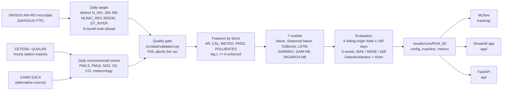

# sp-respiratory-admissions-forecast

**Seven forecasting models, one temporal protocol: daily respiratory hospital admissions in São Paulo city, 1 to 30 days ahead, with every number traceable to an identified run.**

Portfolio repository derived from the master's dissertation of Matheus de Medeiros Pereira (PPGCC/UFSC; advisor Renato Fileto, co-advisor Simone S. Werner). It forecasts the daily count of hospital admissions with a respiratory principal diagnosis (ICD-10 J00 to J99) among residents of the municipality of São Paulo, 2019 to 2024, using Naïve, Seasonal Naïve (m = 7), XGBoost, LSTM, SARIMAX, GAM-NB and INGARCH-NB under the same rolling-origin validation, and asks whether air-quality covariates (PM2.5 first of all) add forecasting value.

> **Every result here is provisional (pre-defence).** The dissertation has not been defended. Numbers are shown with the full id of the run that produced them and may change before the final text. The API and the Streamlit app are engineering demonstrations, not a clinical or operational tool.

[Resumo em português](#resumo-em-português) · [Pipeline](#pipeline) · [Results](#results-provisional) · [How to run](#how-to-run) · [Docs](#documentation) · [What this repo is not](#what-this-repository-is-not)

## What is in the box

| Piece | Where | Notes |
|---|---|---|
| Target series (daily, aggregated) | `data/processed/sih_daily_lookahead.parquet`, `..._urgencia.parquet` | Distinct admissions (`N_AIH`) per day; no microdata. See `data/README.md` |
| Environmental series (daily) | `data/processed/cetesb_*.csv` (main source, CETESB/QUALAR), `data/processed/cams_daily_v2.csv` (alternative source, CAMS) | Attribution and licences in `data/README.md` |
| Feature builder, folds, metrics, quality gate | `src/features`, `src/evaluation`, `src/data` | Single implementations; see `docs/ARCHITECTURE.md` |
| Seven models | `src/models/` | All inherit `Forecaster` (`fit`, `predict`) |
| Benchmark runner | `src/experiments/run_preliminary.py` | Writes `config.json`, `manifest.json`, `metrics.json`, `model_comparison.csv`, `folds.csv` |
| Paired tests | `src/experiments/teste_dm_v02.py` | Diebold–Mariano with Newey–West HAC and Holm correction |
| Ten identified runs | `results/runs/<RUN_ID>/` | 5 horizons × 2 targets, 95,040 predictions each |
| Analyses already computed | `results/analise_multihorizonte/`, `results/numeros_texto_urgencia/`, `results/testes_dm/` | CSV + `proveniencia.json` with sha256 of every input |
| Saturday panel data | `notebooks/dados_painel/` | Aggregates only (see `docs/LESSONS.md`) |
| Demo app, API, tracking | `app/` (Streamlit), `api/` (FastAPI), `tracking/` (MLflow import) | Engineering demonstrations; each folder has its own README or docstring |

## Pipeline



Protocol in one paragraph. The target date is `u`; for horizon `h` the forecast origin is `t = u - h`, and every lagged feature `var_lag<L>` requires `L >= h` (checked at run time, raises otherwise). Calendar features of `u` are the only exception, because they are known in advance. Folds are rolling-origin: four folds, each with 180 test days, test windows contiguous from 2023-01-12 to 2024-12-31, with a 180-day validation slice at the end of each training window for early stopping. XGBoost and LSTM run with five seeds (42 to 46) and are reported as the mean across seeds, never the best seed. MASE divides the model MAE by the Naïve MAE on the same test dates of the same horizon, so it compares models within a horizon only; across horizons use MAE or the skill against the best of Naïve and Seasonal Naïve.

## Results (provisional)

Feature set `AR_CAL` (autoregressive lags of the target + calendar), the set common to all models. Cells are **MAE (admissions per day, 2 decimals) / MASE (3 decimals)**, mean over the 4 folds and, for XGBoost and LSTM, over the 5 seeds. Generated by `docs/scripts/tabela_readme.py` from `results/runs/<RUN_ID>/model_comparison.csv`, cross-checked against `results/analise_multihorizonte/ANALISE_MULTIHORIZONTE_V02_20261118/A_modelos_por_h.csv` and `results/numeros_texto_urgencia/NUMEROS_TEXTO_URGENCIA_V02_20261118/arcal_por_horizonte_dois_alvos.csv`; the script raises if the three disagree. Audit list: `docs/CONFERENCIA_NUMEROS_WP5.md`.

### Total target (all respiratory admissions) · provisional

| Model | h = 1 | h = 5 | h = 7 | h = 15 | h = 30 |
|---|---:|---:|---:|---:|---:|
| XGBoost | 18.56 / 0.645 | 22.50 / 0.656 | 23.40 / 0.810 | 24.34 / 0.654 | 26.36 / 0.698 |
| SARIMAX | 18.92 / 0.660 | 23.04 / 0.674 | 24.37 / 0.845 | 25.84 / 0.698 | 25.32 / 0.668 |
| LSTM | 19.01 / 0.662 | 22.56 / 0.660 | 23.64 / 0.821 | 25.32 / 0.683 | 26.76 / 0.710 |
| INGARCH-NB | 19.55 / 0.681 | 23.59 / 0.690 | 24.71 / 0.857 | 26.39 / 0.713 | 25.47 / 0.674 |
| GAM-NB | 21.91 / 0.763 | 25.35 / 0.741 | 26.28 / 0.909 | 27.24 / 0.734 | 27.52 / 0.726 |
| Naive | 28.71 / 1.000 | 34.13 / 1.000 | 28.87 / 1.000 | 37.05 / 1.000 | 37.84 / 1.000 |
| Seasonal Naive | 28.87 / 1.007 | 28.87 / 0.844 | 28.87 / 1.000 | 33.25 / 0.897 | 34.85 / 0.917 |

| h | Run id | Commit | Clean tree at start | Predictions |
|---:|---|---|---|---:|
| 1 | `h1_v02_cetesb_cetesb_classicos_full_20261022-211834` | `e6a63c3` | yes | 95,040 |
| 5 | `mh_h5_cetesb_cetesb_full_20261110-211453` | `5436606` | yes | 95,040 |
| 7 | `mh_h7_cetesb_cetesb_full_20261111-030322` | `49c2188` | yes | 95,040 |
| 15 | `mh_h15_cetesb_cetesb_full_20261111-070926` | `b5bb35f` | yes | 95,040 |
| 30 | `mh_h30_cetesb_cetesb_full_20261113-104814` | `e4828bc` | yes | 95,040 |

### Urgent target (non-elective admissions) · provisional

| Model | h = 1 | h = 5 | h = 7 | h = 15 | h = 30 |
|---|---:|---:|---:|---:|---:|
| XGBoost | 14.88 / 0.749 | 17.61 / 0.665 | 18.51 / 0.865 | 20.99 / 0.738 | 22.45 / 0.683 |
| SARIMAX | 14.26 / 0.719 | 17.66 / 0.668 | 18.72 / 0.876 | 21.17 / 0.746 | 21.46 / 0.652 |
| LSTM | 14.76 / 0.744 | 17.99 / 0.681 | 18.78 / 0.879 | 21.69 / 0.761 | 22.69 / 0.692 |
| INGARCH-NB | 14.94 / 0.753 | 18.41 / 0.697 | 19.18 / 0.898 | 21.52 / 0.759 | 21.71 / 0.661 |
| GAM-NB | 16.65 / 0.838 | 19.94 / 0.754 | 20.08 / 0.939 | 22.46 / 0.788 | 23.57 / 0.712 |
| Naive | 19.81 / 1.000 | 26.36 / 1.000 | 21.36 / 1.000 | 28.39 / 1.000 | 32.85 / 1.000 |
| Seasonal Naive | 21.36 / 1.076 | 21.36 / 0.809 | 21.36 / 1.000 | 27.05 / 0.952 | 30.41 / 0.922 |

Runs: `ur_h1_cetesb_cetesb_full_20261116-191534`, `ur_h5_cetesb_cetesb_full_20261116-222823`, `ur_h7_cetesb_cetesb_full_20261117-073926`, `ur_h15_cetesb_cetesb_full_20261117-190532`, `ur_h30_cetesb_cetesb_full_20261117-221426` (all with a clean tree at start and 95,040 predictions; the urgent target has not yet been validated against TabNet, status `PRELIMINARY_UNVALIDATED_TARGET` in each `manifest.json`).

### How to read the tables (provisional)

- Within each horizon, XGBoost, SARIMAX and LSTM are not separated by the paired Diebold–Mariano test after Holm correction. At h = 1 (total target) the only significant contrasts among trained models are the four against GAM-NB (`results/analise_multihorizonte/ANALISE_MULTIHORIZONTE_V02_20261118/A2_dm_modelos_por_h.csv`; detail in `results/testes_dm/TESTES_DM_h1_v02_cetesb_cetesb_classicos_full_20261022-211834/RELATORIO_DM.md`). The nominal leader by MAE is XGBoost for h = 1 to 15 on the total target and for h = 5 to 15 on the urgent target; SARIMAX leads at h = 30 on both targets and at h = 1 on the urgent target (same file, column `lider`).
- The MASE column at h = 7 is close to 1 only because the Naïve of h = 7 is the Seasonal Naïve; compare rows, not columns.
- Environmental covariates (PM2.5, other pollutants, meteorology) do not improve `AR_CAL` in a way that survives the paired test; this is the subject of the dissertation and is not settled here.
- On the total target, Saturday is the worst day for every model (XGBoost MAE 33.31 on Saturdays against 16.09 on other days at h = 1, ratio 2.07; `results/numeros_texto_urgencia/NUMEROS_TEXTO_URGENCIA_V02_20261118/erro_sabado_h1.csv`). On the urgent target the ratio is 0.90. The reason is in `docs/LESSONS.md`.

## How to run

Python 3.11 with [uv](https://docs.astral.sh/uv/); the dependency versions are the ones that executed the dissertation runs (`docs/requirements-executado-20260727-163313.txt`, pinned in `pyproject.toml` and `uv.lock`).

```bash
uv sync                      # creates .venv with the locked versions
uv run pytest -q             # test suite (about 5 minutes; includes LSTM, SARIMAX, GAM-NB and INGARCH-NB tests)
uv run python -m src.experiments.run_preliminary --config configs/smoke.yaml --smoke   # pipeline smoke test (never a result)
```

Make targets (`Makefile`): `make test`, `make smoke`, `make app`, `make api`, `make mlflow`.

Docker (`docker-compose.yml`, one image, three services):

```bash
docker compose up            # app (Streamlit) on :8501, api (FastAPI) on :8000, mlflow on :5000
```

- Streamlit app, local: <http://localhost:8501> (see `app/`). Shows the target series, the results by horizon and the Saturday panel, every number read from `results/` or `notebooks/dados_painel/`.
- FastAPI, local: <http://localhost:8000> (see `api/`; `GET /health`, `GET /forecast`). Serves demonstration XGBoost `AR_CAL` models from `models_demo/`, trained on the whole series with one seed, which is **not** the dissertation protocol; the model card (`models_demo/MODEL_CARD.md`) says so. Because the canonical feature builder only materialises observed target dates, the API answers only for origins whose target `origem + h` falls inside the 2019–2024 history (in-sample by construction).
- MLflow, local: <http://localhost:5000>. `tracking/importar_runs.py` copies `config.json`, `manifest.json` and `metrics.json` of the runs in `results/runs/` into a file store; nothing is recomputed.

To reproduce a run exactly from its `config.json`, see `docs/REPRODUCIBILITY.md`.

## Documentation

- `docs/ARCHITECTURE.md`: modules, contracts and the fail-loud rules.
- `docs/REPRODUCIBILITY.md`: how to rerun a run from `results/runs/<RUN_ID>/config.json`, what is pinned, and what is not reproducible (CAMS canonical file, microdata).
- `docs/LESSONS.md`: four things that went wrong or surprised us, each with the file that proves it.
- `data/README.md`: data card (sources, licences, construction rules, columns, exclusions).
- `docs/DECISOES.md`: author decisions D1 to D7 for this repository (in Portuguese).
- `docs/CONFERENCIA_NUMEROS_WP5.md`: every number in this README and in the docs, with the file and key it was checked against.
- `docs/INVENTARIO_FASE0.tsv`: provenance (origin path and sha256) of every file copied from the dissertation repository.

## What this repository is not

- It is **not the dissertation**. The text, the literature review and the final conclusions live elsewhere and are still being written; the numbers here can change before the defence.
- It contains **no microdata**: only daily aggregates of SIH/SUS and daily station aggregates of CETESB and CAMS. No `N_AIH`, no patient, no establishment-level record beyond the aggregated Saturday panel (establishment × year with fewer than 5 admissions suppressed).
- Nothing is published about the LSTM (or any model) beyond what is in `results/`: no trained weights, no per-seed artefacts, no hyper-parameter search beyond the configured values.
- The API is an engineering demonstration. Its models are not the benchmark models and must not be used for planning or care.
- TCN, TFT, SHAP and other extensions that appear in the dissertation plan were not executed and are not described here.

## Resumo em português

Repositório de portfólio derivado da dissertação de mestrado de Matheus de Medeiros Pereira (PPGCC/UFSC; orientador Renato Fileto, coorientadora Simone S. Werner). Prevê a contagem diária de internações hospitalares com diagnóstico principal respiratório (CID-10 J00 a J99) de residentes do município de São Paulo, 2019 a 2024, de 1 a 30 dias à frente (h ∈ {1, 5, 7, 15, 30}), com sete modelos (Naïve, Seasonal Naïve m = 7, XGBoost, LSTM, SARIMAX, GAM-NB e INGARCH-NB) sob um único protocolo: 4 folds rolling-origin com 180 dias de teste cada, 5 sementes para XGBoost e LSTM reportadas como média (nunca a melhor semente), e teste pareado de Diebold–Mariano com correção de Holm. A fonte ambiental principal é a CETESB/QUALAR; o CAMS (Copernicus) é fonte alternativa. Há dois alvos: o total de internações (previsão de demanda) e as internações de urgência (caráter não eletivo), que isolam a pergunta sobre o PM2,5 do ruído das cirurgias eletivas de sábado (ver `docs/LESSONS.md`).

**Todo resultado é provisório (pré-defesa).** Cada número vem com o id completo da run que o gerou (`results/runs/<RUN_ID>/`); as tabelas acima são geradas por `docs/scripts/tabela_readme.py` a partir dos CSV, sem digitação, e a lista de conferência está em `docs/CONFERENCIA_NUMEROS_WP5.md`. Leitura provisória: dentro de cada horizonte, XGBoost, SARIMAX e LSTM não se separam pelo teste pareado; as covariáveis ambientais não melhoram o conjunto `AR_CAL` de forma que sobreviva ao teste. A API e o app são demonstrações de engenharia, não ferramentas clínicas. O repositório não contém microdados e não é a dissertação.

Para rodar: `uv sync`, `uv run pytest -q`, `uv run python -m src.experiments.run_preliminary --config configs/smoke.yaml --smoke`; ou `docker compose up` (app em :8501, API em :8000, MLflow em :5000). Reprodução exata de uma run: `docs/REPRODUCIBILITY.md`.

## Licence and citation

Code: MIT (`LICENSE`). Data: licence of each source, stated in `data/README.md`. To cite the software, use `CITATION.cff`.
