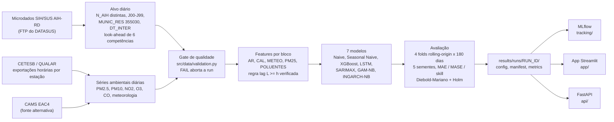

# sp-respiratory-admissions-forecast

🇬🇧 [English version](README.md) · 🇧🇷 Português (este arquivo)

[](https://github.com/matheusmmmp/sp-respiratory-admissions-forecast/actions/workflows/ci.yml) [](https://sp-respiratory-admissions-forecast.streamlit.app)  [](LICENSE)

**Sete modelos de previsão, um protocolo temporal: internações hospitalares respiratórias diárias no município de São Paulo, de 1 a 30 dias à frente, com todo número rastreável a uma run identificada.**

Repositório de portfólio derivado da dissertação de mestrado de Matheus de Medeiros Pereira (PPGCC/UFSC; orientador Renato Fileto, coorientadora Simone S. Werner). Prevê a contagem diária de internações hospitalares com diagnóstico principal respiratório (CID-10 J00 a J99) de residentes do município de São Paulo, 2019 a 2024, com Naïve, Seasonal Naïve (m = 7), XGBoost, LSTM, SARIMAX, GAM-NB e INGARCH-NB sob a mesma validação rolling-origin, e pergunta se covariáveis de qualidade do ar (PM2,5 antes de tudo) acrescentam valor preditivo.

> **Todo resultado aqui é provisório (pré-defesa).** A dissertação ainda não foi defendida. Os números aparecem com o id completo da run que os gerou e podem mudar antes do texto final. A API e o app Streamlit são demonstrações de engenharia, não uma ferramenta clínica ou operacional.

[Pipeline](#pipeline) · [Resultados](#resultados-provisórios) · [Como rodar](#como-rodar) · [Documentação](#documentação) · [O que este repositório não é](#o-que-este-repositório-não-é)

## O que há aqui

| Peça | Onde | Notas |
|---|---|---|
| Série-alvo (diária, agregada) | `data/processed/sih_daily_lookahead.parquet`, `..._urgencia.parquet` | Internações distintas (`N_AIH`) por dia; sem microdados. Ver `data/README.md` |
| Séries ambientais (diárias) | `data/processed/cetesb_*.csv` (fonte principal, CETESB/QUALAR), `data/processed/cams_daily_v2.csv` (fonte alternativa, CAMS) | Atribuição e licenças em `data/README.md` |
| Construtor de features, folds, métricas, gate de qualidade | `src/features`, `src/evaluation`, `src/data` | Implementações únicas; ver `docs/ARCHITECTURE.md` |
| Sete modelos | `src/models/` | Todos herdam `Forecaster` (`fit`, `predict`) |
| Runner do benchmark | `src/experiments/run_preliminary.py` | Escreve `config.json`, `manifest.json`, `metrics.json`, `model_comparison.csv`, `folds.csv` |
| Testes pareados | `src/experiments/teste_dm_v02.py` | Diebold–Mariano com HAC de Newey–West e correção de Holm |
| Dez runs identificadas | `results/runs/<RUN_ID>/` | 5 horizontes × 2 alvos, 95.040 previsões cada |
| Análises já calculadas | `results/analise_multihorizonte/`, `results/numeros_texto_urgencia/`, `results/testes_dm/` | CSV + `proveniencia.json` com o sha256 de cada entrada |
| Dados do painel do sábado | `notebooks/dados_painel/` | Só agregados (ver `docs/LESSONS.md`) |
| App de demonstração, API, tracking | `app/` (Streamlit), `api/` (FastAPI), `tracking/` (importação para o MLflow) | Demonstrações de engenharia; cada pasta tem o próprio README ou docstring |

## Pipeline



O protocolo em um parágrafo. A data-alvo é `u`; para o horizonte `h` a origem da previsão é `t = u - h`, e toda feature defasada `var_lag<L>` exige `L >= h` (verificado em tempo de execução; levanta exceção se violado). As features de calendário de `u` são a única exceção, porque são conhecidas com antecedência. Os folds são rolling-origin: quatro folds, cada um com 180 dias de teste, janelas de teste contíguas de 2023-01-12 a 2024-12-31, com uma fatia de validação de 180 dias no fim de cada janela de treino para early stopping. XGBoost e LSTM rodam com cinco sementes (42 a 46) e são reportados pela média entre sementes, nunca pela melhor semente. O MASE divide o MAE do modelo pelo MAE do Naïve nas mesmas datas de teste do mesmo horizonte, portanto compara modelos só dentro de um horizonte; entre horizontes use o MAE ou a skill contra o melhor entre Naïve e Seasonal Naïve.

## Resultados (provisórios)

Conjunto de features `AR_CAL` (defasagens autorregressivas do alvo + calendário), o conjunto comum a todos os modelos. As células são **MAE (internações por dia, 2 casas) / MASE (3 casas)**, média dos 4 folds e, para XGBoost e LSTM, das 5 sementes. Geradas por `docs/scripts/tabela_readme.py --lang pt` a partir de `results/runs/<RUN_ID>/model_comparison.csv`, conferidas contra `results/analise_multihorizonte/ANALISE_MULTIHORIZONTE_V02_20261118/A_modelos_por_h.csv` e `results/numeros_texto_urgencia/NUMEROS_TEXTO_URGENCIA_V02_20261118/arcal_por_horizonte_dois_alvos.csv`; o script levanta exceção se os três discordarem. O ponto decimal das tabelas é mantido como nos arquivos de origem. Lista de conferência: `docs/CONFERENCIA_NUMEROS_WP5.md`.

### Alvo total (todas as internações respiratórias) · provisório

| Modelo | h = 1 | h = 5 | h = 7 | h = 15 | h = 30 |
|---|---:|---:|---:|---:|---:|
| XGBoost | 18.56 / 0.645 | 22.50 / 0.656 | 23.40 / 0.810 | 24.34 / 0.654 | 26.36 / 0.698 |
| SARIMAX | 18.92 / 0.660 | 23.04 / 0.674 | 24.37 / 0.845 | 25.84 / 0.698 | 25.32 / 0.668 |
| LSTM | 19.01 / 0.662 | 22.56 / 0.660 | 23.64 / 0.821 | 25.32 / 0.683 | 26.76 / 0.710 |
| INGARCH-NB | 19.55 / 0.681 | 23.59 / 0.690 | 24.71 / 0.857 | 26.39 / 0.713 | 25.47 / 0.674 |
| GAM-NB | 21.91 / 0.763 | 25.35 / 0.741 | 26.28 / 0.909 | 27.24 / 0.734 | 27.52 / 0.726 |
| Naive | 28.71 / 1.000 | 34.13 / 1.000 | 28.87 / 1.000 | 37.05 / 1.000 | 37.84 / 1.000 |
| Seasonal Naive | 28.87 / 1.007 | 28.87 / 0.844 | 28.87 / 1.000 | 33.25 / 0.897 | 34.85 / 0.917 |

| h | Id da run | Commit | Árvore limpa no início | Previsões |
|---:|---|---|---|---:|
| 1 | `h1_v02_cetesb_cetesb_classicos_full_20261022-211834` | `e6a63c3` | sim | 95.040 |
| 5 | `mh_h5_cetesb_cetesb_full_20261110-211453` | `5436606` | sim | 95.040 |
| 7 | `mh_h7_cetesb_cetesb_full_20261111-030322` | `49c2188` | sim | 95.040 |
| 15 | `mh_h15_cetesb_cetesb_full_20261111-070926` | `b5bb35f` | sim | 95.040 |
| 30 | `mh_h30_cetesb_cetesb_full_20261113-104814` | `e4828bc` | sim | 95.040 |

### Alvo de urgência (internações não eletivas) · provisório

| Modelo | h = 1 | h = 5 | h = 7 | h = 15 | h = 30 |
|---|---:|---:|---:|---:|---:|
| XGBoost | 14.88 / 0.749 | 17.61 / 0.665 | 18.51 / 0.865 | 20.99 / 0.738 | 22.45 / 0.683 |
| SARIMAX | 14.26 / 0.719 | 17.66 / 0.668 | 18.72 / 0.876 | 21.17 / 0.746 | 21.46 / 0.652 |
| LSTM | 14.76 / 0.744 | 17.99 / 0.681 | 18.78 / 0.879 | 21.69 / 0.761 | 22.69 / 0.692 |
| INGARCH-NB | 14.94 / 0.753 | 18.41 / 0.697 | 19.18 / 0.898 | 21.52 / 0.759 | 21.71 / 0.661 |
| GAM-NB | 16.65 / 0.838 | 19.94 / 0.754 | 20.08 / 0.939 | 22.46 / 0.788 | 23.57 / 0.712 |
| Naive | 19.81 / 1.000 | 26.36 / 1.000 | 21.36 / 1.000 | 28.39 / 1.000 | 32.85 / 1.000 |
| Seasonal Naive | 21.36 / 1.076 | 21.36 / 0.809 | 21.36 / 1.000 | 27.05 / 0.952 | 30.41 / 0.922 |

Runs: `ur_h1_cetesb_cetesb_full_20261116-191534`, `ur_h5_cetesb_cetesb_full_20261116-222823`, `ur_h7_cetesb_cetesb_full_20261117-073926`, `ur_h15_cetesb_cetesb_full_20261117-190532`, `ur_h30_cetesb_cetesb_full_20261117-221426` (todas com árvore limpa no início e 95.040 previsões; o alvo de urgência ainda não foi validado contra o TabNet, status `PRELIMINARY_UNVALIDATED_TARGET` em cada `manifest.json`).

### Como ler as tabelas (provisório)

- Dentro de cada horizonte, XGBoost, SARIMAX e LSTM não se separam pelo teste pareado de Diebold–Mariano com correção de Holm. Em h = 1 (alvo total) os únicos contrastes significativos entre modelos treinados são os quatro contra o GAM-NB (`results/analise_multihorizonte/ANALISE_MULTIHORIZONTE_V02_20261118/A2_dm_modelos_por_h.csv`; detalhe em `results/testes_dm/TESTES_DM_h1_v02_cetesb_cetesb_classicos_full_20261022-211834/RELATORIO_DM.md`). O líder nominal pelo MAE é o XGBoost em h = 1 a 15 no alvo total e em h = 5 a 15 no alvo de urgência; o SARIMAX lidera em h = 30 nos dois alvos e em h = 1 no alvo de urgência (mesmo arquivo, coluna `lider`).
- A coluna de MASE em h = 7 fica perto de 1 só porque o Naïve de h = 7 é o Seasonal Naïve; compare linhas, não colunas.
- Covariáveis ambientais (PM2,5, outros poluentes, meteorologia) raramente melhoram um modelo após o teste pareado. No alvo total em h = 1, nenhum dos 10 contrastes de ablação por modelo o melhora após Holm (7 contrastes significativos, todos com a covariável pior). Nas 10 runs aqui exibidas (5 horizontes × 2 alvos, 500 contrastes em `results/analise_multihorizonte/ANALISE_MULTIHORIZONTE_V02_20261118/B2_dm_ablacao_por_h.csv`), 59 contrastes são significativos após Holm: 53 com o bloco acrescentado pior e 6 com ele melhor (DM < 0): SARIMAX, urgência, h = 1, média de PM2,5 acrescentada a `AR_CAL` (p de Holm 0,005) e poluentes acrescentados a `AR_CAL` (0,014); XGBoost, urgência, h = 15, poluentes acrescentados sobre a meteorologia (0,001); LSTM, média de PM2,5 acrescentada sobre a meteorologia em h = 7 no alvo total (0,001) e em h = 5 (0,007) e h = 7 (0,026) no alvo de urgência. Quais desses sobrevivem aos critérios da própria dissertação é assunto da dissertação e não se decide aqui.
- No alvo total, o sábado é o pior dia para todos os modelos (MAE do XGBoost 33,31 nos sábados contra 16,09 nos demais dias em h = 1, razão 2,07; `results/numeros_texto_urgencia/NUMEROS_TEXTO_URGENCIA_V02_20261118/erro_sabado_h1.csv`). No alvo de urgência a razão é 0,90. A explicação está em `docs/LESSONS.md`.

## Como rodar

Python 3.11 com [uv](https://docs.astral.sh/uv/); as versões das dependências são as que executaram as runs da dissertação (`docs/requirements-executado-20260727-163313.txt`, travadas em `pyproject.toml` e `uv.lock`).

```bash
uv sync                      # cria o .venv com as versões travadas
uv run pytest -q             # suíte de testes: alguns minutos (3m52s na máquina do autor, 2026-11-23); inclui testes de LSTM, SARIMAX, GAM-NB e INGARCH-NB
uv run python -m src.experiments.run_preliminary --config configs/smoke.yaml --smoke   # teste de fumaça do pipeline (nunca é resultado)
```

Alvos do `Makefile`: `make test`, `make smoke`, `make app`, `make api`, `make mlflow`.

Docker (`docker-compose.yml`, uma imagem, três serviços):

```bash
docker compose up            # app (Streamlit) em :8501, api (FastAPI) em :8000, mlflow em :5000
```

- App Streamlit, no ar: <https://sp-respiratory-admissions-forecast.streamlit.app> (Streamlit Community Cloud, publicado em 2026-11-23; seletor de idioma PT/EN em todas as páginas, link direto em português: <https://sp-respiratory-admissions-forecast.streamlit.app/?lang=pt>); local: <http://localhost:8501> (ver `app/`). Mostra a série-alvo, os resultados por horizonte e o painel do sábado, com todo número lido de `results/` ou de `notebooks/dados_painel/`.
- FastAPI, local: <http://localhost:8000> (ver `api/`; `GET /health`, `GET /forecast`). Serve modelos XGBoost `AR_CAL` de demonstração de `models_demo/`, treinados na série inteira com uma semente, o que **não** é o protocolo da dissertação; o model card (`models_demo/MODEL_CARD.md`) diz isso. Como o construtor de features canônico só materializa datas-alvo observadas, a API responde só para origens cuja data-alvo `origem + h` cai dentro do histórico 2019–2024 (in-sample por construção).
- MLflow, local: <http://localhost:5000>. `tracking/importar_runs.py` copia `config.json`, `manifest.json` e `metrics.json` das runs em `results/runs/` para um file store; nada é recalculado.

O Streamlit Community Cloud publica o app a partir de `app/Home.py` com `app/requirements.txt` (só os cinco pacotes de que o app precisa; o arquivo fica ao lado do ponto de entrada para que o Community Cloud o use em vez do `uv.lock`). Python 3.11.

Para reproduzir uma run exatamente a partir do seu `config.json`, ver `docs/REPRODUCIBILITY.md`.

## Documentação

A documentação em `docs/` e o data card estão em inglês (decisão do autor: só o README existe nas duas línguas).

- `docs/ARCHITECTURE.md`: módulos, contratos e as regras de falhar alto.
- `docs/REPRODUCIBILITY.md`: como reexecutar uma run a partir de `results/runs/<RUN_ID>/config.json`, o que está travado e o que não é reproduzível (arquivo canônico do CAMS, microdados).
- `docs/LESSONS.md`: quatro coisas que deram errado ou nos surpreenderam, cada uma com o arquivo que a comprova.
- `data/README.md`: data card (fontes, licenças, regras de construção, colunas, exclusões).
- `docs/DECISOES.md`: decisões do autor D1 a D7 para este repositório (em português).
- `docs/CONFERENCIA_NUMEROS_WP5.md`: todo número deste README, do `README.md` e dos docs, com o arquivo e a chave contra os quais foi conferido.
- `docs/INVENTARIO_FASE0.tsv`: proveniência (caminho de origem e sha256) de cada arquivo copiado do repositório da dissertação.

## O que este repositório não é

- **Não é a dissertação.** O texto, a revisão de literatura e as conclusões finais vivem em outro lugar e ainda estão sendo escritos; os números daqui podem mudar antes da defesa.
- **Não contém microdados**: só agregados diários do SIH/SUS e agregados diários por estação da CETESB e do CAMS. Nenhum `N_AIH`, nenhum paciente, nenhum registro por estabelecimento além do painel agregado do sábado (estabelecimento × ano com menos de 5 internações suprimido).
- Nada é publicado sobre a LSTM (ou qualquer modelo) além do que está em `results/`: nenhum peso treinado, nenhum artefato por semente, nenhuma busca de hiperparâmetros além dos valores configurados.
- A API é uma demonstração de engenharia. Seus modelos não são os modelos do benchmark e não devem ser usados para planejamento ou assistência.
- TCN, TFT, SHAP e outras extensões que aparecem no plano da dissertação não foram executadas e não são descritas aqui.

## Licença e citação

Código: MIT (`LICENSE`). Dados: licença de cada fonte, declarada em `data/README.md`. Para citar o software, use `CITATION.cff`.
